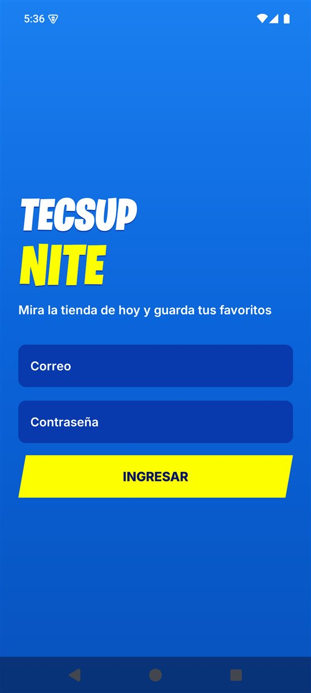
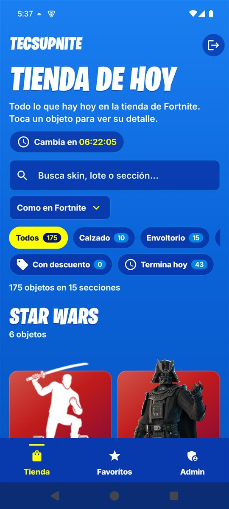
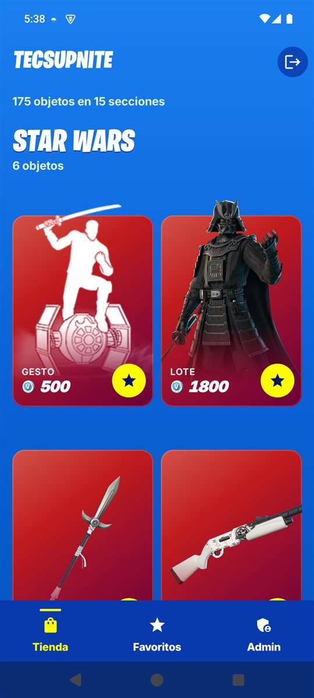
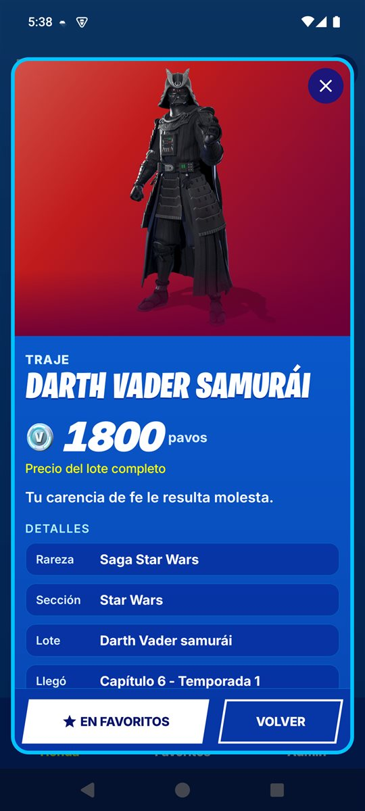
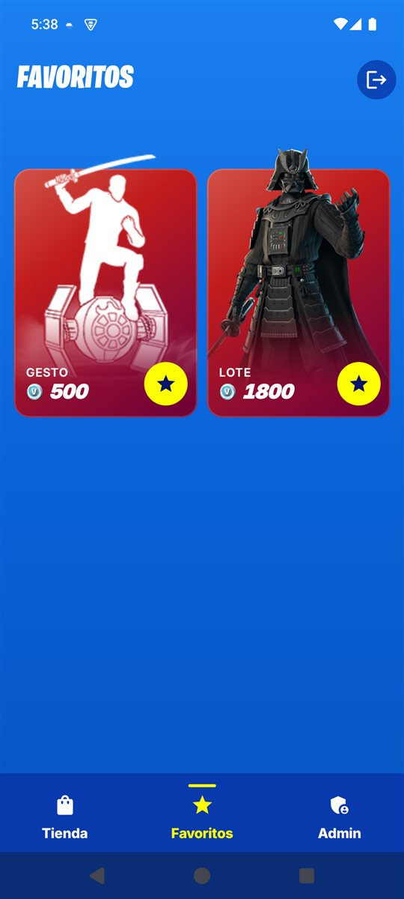
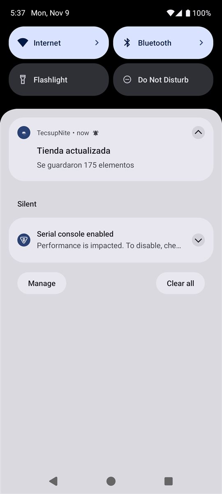
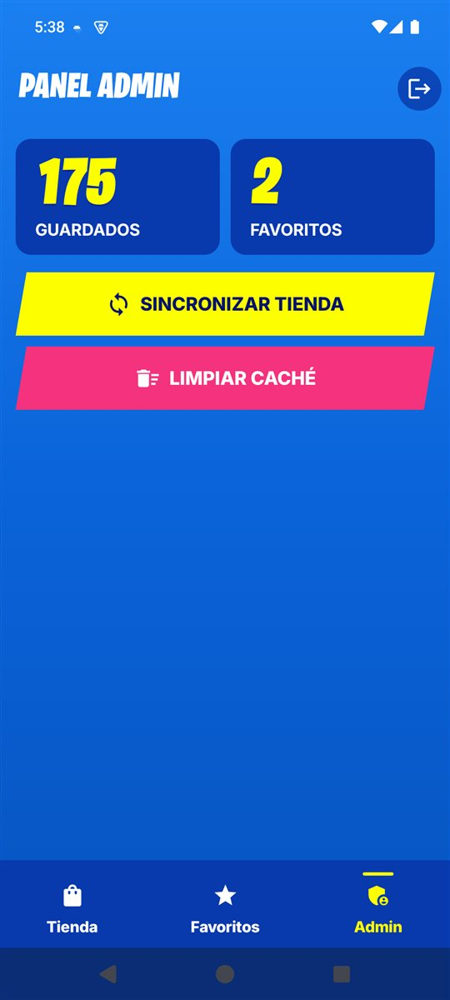

# TecsupNite

Laboratorio 11-12 de Programación en Móviles (modalidad individual).
App Android en Kotlin con Jetpack Compose y Material 3 que muestra la tienda de cosméticos de Fortnite.

- **Alumno:** Renzo León
- **Tema:** Fortnite (API pública de https://fortnite-api.com, sin clave)
- **Paquete:** `com.tecsup.fortnite`
- **Variante:** tienda de hoy (`/v2/shop`) con detalle por cosmético; sin pistas musicales, instrumentos ni autos.
- **Reparto de tareas:** trabajo individual; todo el proyecto (código, Firebase, pruebas, README y capturas) lo hizo Renzo León.
- **Guía para presentar:** [GUIA-PRESENTACION.md](GUIA-PRESENTACION.md) dice dónde está cada archivo y cada requisito.
- **APK:** [release v1.0](https://github.com/RXDG2908/Moviles-Android-CD/releases/tag/v1.0)
- **Credenciales:** [CREDENCIALES.md](CREDENCIALES.md) (usuarios de prueba y Firebase)
- **Instalar en otra PC:** [CLAUDE.md](CLAUDE.md), con los pasos para Android Studio del instituto

## Qué hace

- Login con correo y contraseña (Firebase Authentication) con dos roles: `admin` y `usuario`.
- Lista de la tienda de hoy con foto, rareza, precio en V-Bucks, buscador y chips por tipo.
- Detalle de un cosmético (segundo endpoint).
- Favoritos que se guardan en el celular y se conservan al sincronizar.
- Modo sin conexión: sin internet muestra lo guardado con un aviso.
- Notificación local «Se guardaron N elementos» al terminar de sincronizar.
- Panel Admin (solo admin): total guardado, total de favoritos, Sincronizar y Limpiar caché.
- Sesión que se mantiene al reabrir y botón Cerrar sesión.

Se descartan las pistas musicales, los instrumentos y los autos de la tienda; solo se muestran cosméticos de Battle Royale. Los packs aparecen como «Lote», con su nombre, su imagen y el precio del pack; el detalle muestra el primer cosmético e indica que el precio es del lote. Si un cosmético también se vende solo, se muestra solo ese y no el lote.

Los favoritos se conservan aunque ya no estén en la tienda de hoy, por eso también pueden aparecer en la lista.

## Diseño

Basado en la tienda de regalitos.shop (proyecto propio, reglas en `WEB.md` de ese repo), adaptado a Android con Material 3:

- **Colores** (tokens de la web): azul tienda `#0a63d8` en degradado sólido, sin dibujos de fondo; paneles `rgba(5,22,138,.55)`; chips con borde `#00c3fe`; amarillo `#fdff00` como único acento de acción.
- **Fuentes**: Burbank (la del juego) solo en títulos, inclinada -6° y en mayúsculas; Inter en el resto (licencia SIL OFL, https://github.com/rsms/inter). Los precios van en Inter negra itálica.
- **Formas**: botones en paralelogramo sin radio; paneles 20 dp, tarjetas 16 dp, campos 10 dp; chips en píldora con su contador.
- **Orden de la tienda** (igual que la web): cabecera con «Cambia en» (cuenta regresiva al cambio de tienda), búsqueda y orden (Como en Fortnite / Menor precio / Mayor precio), filtros por tipo y por «Con descuento» / «Termina hoy», resumen «N objetos en M secciones» y las secciones reales de la tienda (One Piece, Star Wars…).
- **Tarjetas** (Plantilla Prime de la web): fondo con los colores oficiales de cada oferta en el 85 % de abajo, la imagen asoma por arriba y se difumina para leer el precio; solo llevan el tipo y el precio (el nombre va en el detalle), placas «X de descuento» y «Termina hoy», y botón amarillo para favoritos.
- **Barra inferior**: la pestaña activa en amarillo con una raya arriba.
- **Hoja del producto** (como el `<dialog class="hoja">` de la web, skill `law-of-figure-ground`): se abre encima de la tienda con un velo detrás; borde celeste, imagen arriba con los colores oficiales que se funden abajo, tipo y «Termina hoy», nombre en Burbank, precio grande, descripción, fichas de detalles (rareza, sección, serie, llegada) y los botones «A favoritos» / «Volver» siempre abajo.

## Capturas

Tomadas en el emulador con la tienda real del 09/11/2026 y la cuenta admin.

| Login | Tienda de hoy | Secciones y favoritos |
|---|---|---|
|  |  |  |

| Hoja del producto | Favoritos | Notificación | Panel Admin |
|---|---|---|---|
|  |  |  |  |

## Endpoints

| Uso | Endpoint |
| --- | --- |
| Lista | `GET https://fortnite-api.com/v2/shop?language=es` |
| Detalle | `GET https://fortnite-api.com/v2/cosmetics/br/{id}?language=es` |

## Arquitectura (MVVM)

```
data/remote   ApiService, RetrofitClient, dto/ItemDto
data/local    ItemEntity, ItemDao, AppDatabase (Room)
data/auth     AuthRepository (interface), FirebaseAuthRepository
data/repository  ItemRepository (interface), ItemRepositoryImpl
data/mapper   Dto -> Entity -> Item
domain/model  Item, Sesion, Rol
notification  Notificador (interface), NotificadorAndroid
ui/           pantallas y ViewModels: login, lista, detalle, favoritos, admin
```

Room es la fuente de verdad: la lista que ve el usuario sale siempre de Room y Retrofit solo la actualiza.

## Cómo compilar

1. Abrir la carpeta `TecsupNite` en Android Studio.
2. Crear un proyecto en Firebase con el paquete `com.tecsup.fortnite` y descargar `google-services.json` dentro de `app/` (el de este proyecto ya está en el repo).
3. En Firebase activar Authentication con correo y contraseña, y crear Firestore.
4. Crear los usuarios de prueba (ver abajo) y pegar las reglas de seguridad.
5. Ejecutar en un emulador con Google Play.

## Usuarios de prueba

Se crean en Authentication → Usuarios. La contraseña está en [`CREDENCIALES.md`](CREDENCIALES.md).

| Rol | Correo |
| --- | --- |
| Admin | `admin@tecsupnite.com` |
| Usuario | `usuario@tecsupnite.com` |

En Firestore, colección `usuarios`, un documento por usuario con el **UID** como ID y los campos `rol` (`admin` o `usuario`) y `nombre`.

Reglas de Firestore:

```
rules_version = '2';
service cloud.firestore {
  match /databases/{database}/documents {
    match /usuarios/{uid} {
      allow read: if request.auth != null && request.auth.uid == uid;
      allow write: if false;
    }
  }
}
```

## Avance

Fase 1 (rama `main`, sin IA)

- [x] H1 a H4: proyecto base, estructura MVVM y lista
- [x] H5 a H7: Retrofit, lista con estados y detalle
- [x] H8 a H11: Room, favoritos y modo sin conexión
- [x] H12 a H15: login con roles, panel Admin y notificación local
- [x] H16: este README

Pruebas de aceptación de la guía, hechas en el emulador `Lab03` con la tienda real y Firebase real:

| Código | Caso | Resultado |
|---|---|---|
| PA-01 | Ingresar con el usuario `usuario` | Entra a la tienda; no ve la pestaña Admin |
| PA-02 | Ingresar con el usuario `admin` | Entra y ve la pestaña Admin con el panel |
| PA-03 | Contraseña incorrecta | Mensaje claro; no entra |
| PA-04 | Correo o clave vacíos | Validación en pantalla; no llama a Firebase |
| PA-05 | Primera apertura con internet | Cargando, luego la lista y la notificación «Se guardaron N elementos» |
| PA-06 | Tocar un elemento | Detalle con datos del segundo endpoint |
| PA-07 | Marcar favorito y cerrar la app | Al reabrir sigue en Favoritos |
| PA-08 | Modo avión con datos guardados | Se ve la lista con el aviso de sin conexión |
| PA-09 | Modo avión sin datos | Pantalla de error con Reintentar |
| PA-10 | Sincronizar después de marcar un favorito | El favorito no se pierde |
| PA-11 | Admin pulsa Limpiar caché | Totales en 0; al sincronizar vuelven los datos |
| PA-12 | Cerrar sesión y reabrir | Vuelve al login |
| PA-13 | Girar la pantalla | Se mantiene el estado; la tienda usa más columnas |
| PA-14 | Negar el permiso de notificaciones | La app funciona normal, sin avisos |

Estado de la entrega

- [x] Las 14 pruebas de aceptación pasan (tabla de arriba)
- [x] Documentos `usuarios/{uid}` creados en Firestore para el admin y el usuario
- [x] Capturas de login, lista, detalle, favoritos, panel Admin y notificación (sección «Capturas»)
- [x] Fase 2 hecha en la rama `mejora-ia` (pruebas unitarias, mejoras con IA y `PROMPTS.md`); se entrega en esa rama, sin Pull Request porque `main` y `mejora-ia` tienen historias separadas desde labs anteriores
- [x] `main` y `mejora-ia` subidas a GitHub
- [x] Versión `v1.0` publicada en GitHub (Releases) con el APK de depuración adjunto
- [x] Guía de presentación en [`GUIA-PRESENTACION.md`](GUIA-PRESENTACION.md)
- [x] Una línea de comentario al inicio de cada archivo (código, Gradle, XML y reglas)
