# CampusGPS

Laboratorio 13 de Programación en Móviles: localización geográfica.

CampusGPS obtiene la ubicación del celular, la muestra en un mapa y dice qué lugar
del campus está más cerca. Muestra cinco lugares ficticios (biblioteca, cafetería,
laboratorio, auditorio y estacionamiento) con su distancia en metros, ordenados del
más cercano al más lejano. Si el usuario niega el permiso, apaga el GPS o el
celular no tiene Google Play Services, la app no se cierra: muestra un mensaje y una
acción para resolverlo.

- **Alumno:** Renzo Raúl León Fernández
- **Modalidad:** individual
- **Paquete:** `com.leon.campusgps`
- **Tecnología:** Kotlin, Jetpack Compose, Material 3, Google Play Services
  Location y Maps Compose
- **Patrón:** MVVM + Repository

## Estructura de paquetes

```
com.leon.campusgps/
├── MainActivity.kt
├── model/
│   └── Modelos.kt                    Posicion, Lugar, LugarConDistancia, UbicacionUi, TipoError
├── data/
│   ├── UbicacionRepository.kt        interface
│   ├── UbicacionRepositoryGoogle.kt  implementación con Fused
│   ├── LugaresRepository.kt          interface
│   └── LugaresRepositoryLocal.kt     los 5 lugares
├── util/
│   ├── Distancia.kt                  distanciaMetros con Location.distanceBetween
│   └── Formato.kt                    formatearDistancia: 350 m o 1.5 km
├── viewmodel/
│   ├── MapaViewModel.kt
│   └── CampusViewModelFactory.kt
└── ui/
    ├── PantallaMapa.kt
    ├── MapaUbicacion.kt
    ├── ListaLugares.kt
    ├── MensajeError.kt
    ├── FiltroCategorias.kt           chips de categoría (Fase 2)
    ├── SelectorRadio.kt              chips de 100, 200 y 500 m (Fase 2)
    ├── Iconos.kt                     iconos por categoría, punto en vivo y efecto al presionar (Fase 2)
    └── theme/
```

## Arquitectura MVVM + Repository

```
View (PantallaMapa)
   |  evento: pulsar el botón        ^  collectAsState()
   v                                 |
ViewModel (MapaViewModel)  --- StateFlow --->
   |  llama a las interfaces
   v
UbicacionRepository  ---> UbicacionRepositoryGoogle (FusedLocationProviderClient)
LugaresRepository    ---> LugaresRepositoryLocal (los 5 lugares fijos)
```

| Capa | Conoce a | No hace |
|---|---|---|
| View (`ui/`) | Solo a su ViewModel | No usa el Repository ni FusedLocationProviderClient, y no calcula distancias |
| ViewModel | Solo a las interfaces de Repository | No conoce Composables ni recibe un `Context` |
| Repository | Google Play Services (en la implementación) | No expone clases de UI |
| `util/` | Funciones puras (distancia y formato) | No guarda estado |

## Capturas

Tomadas en el emulador `CampusGPS_Play` (Pixel 7, API 35 con Google Play) con la
ubicación en el punto base `-12.0464, -77.0428`.

| Permiso | Mapa con mi ubicación | Marcadores |
|---|---|---|
| 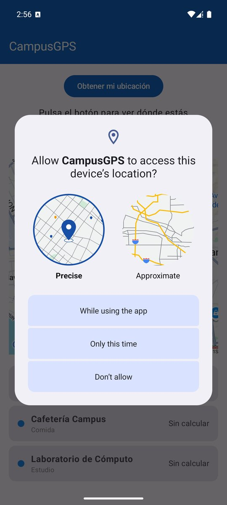 | 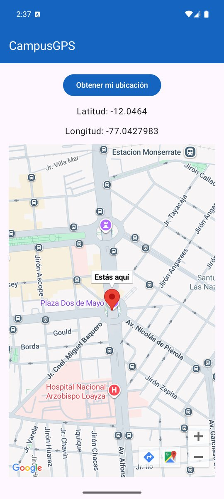 | 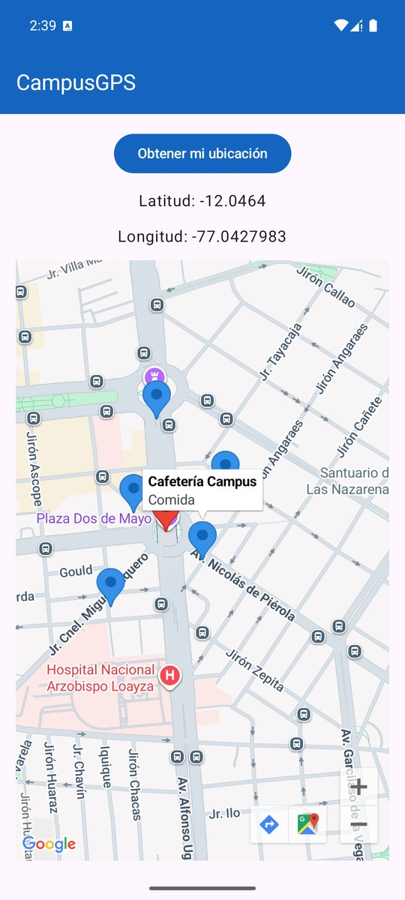 |

| Lista ordenada | Lugar seleccionado | Más cercano en verde |
|---|---|---|
| 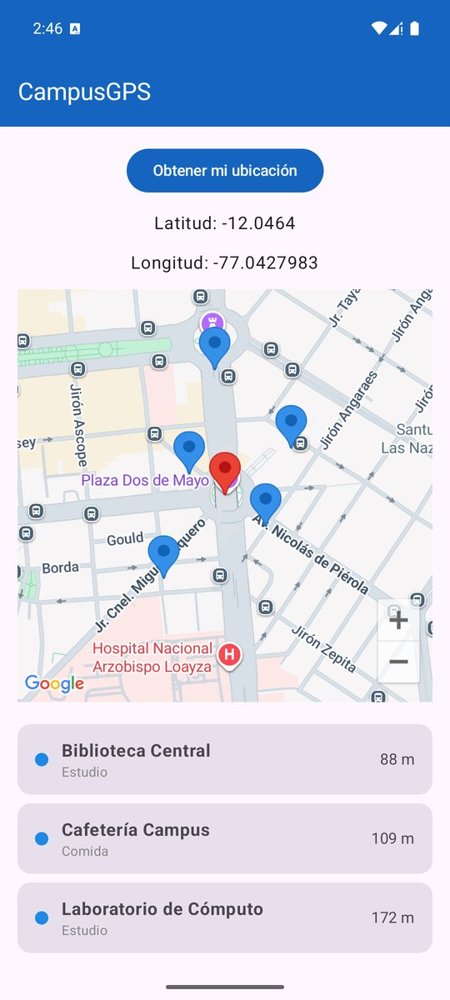 | 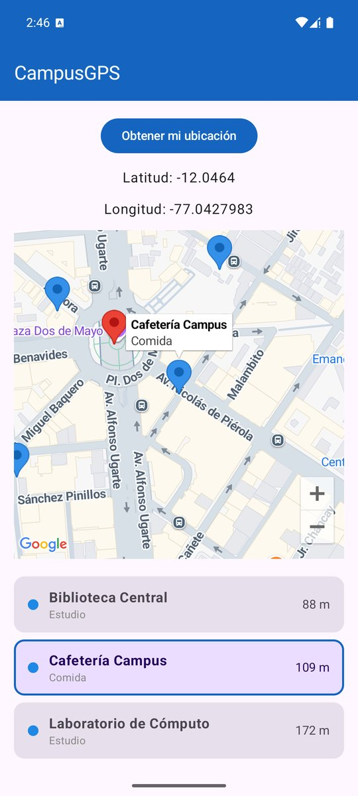 | 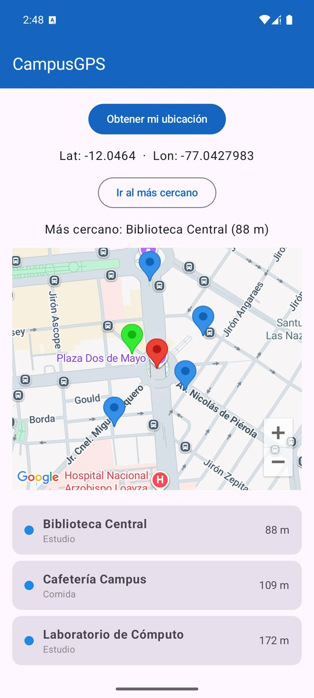 |

| Error: sin permiso | Error: GPS apagado | Error: sin Play Services |
|---|---|---|
| 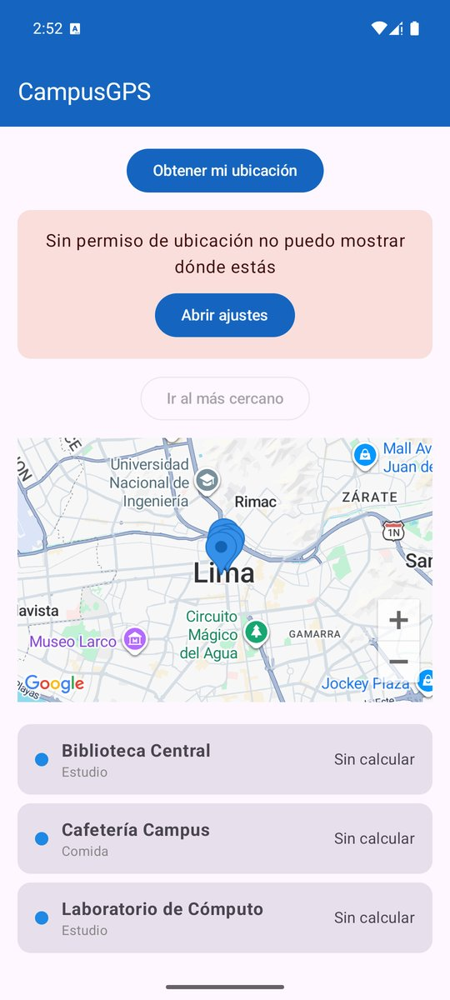 | 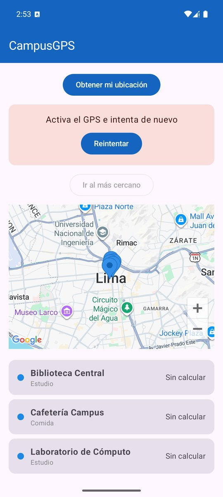 | 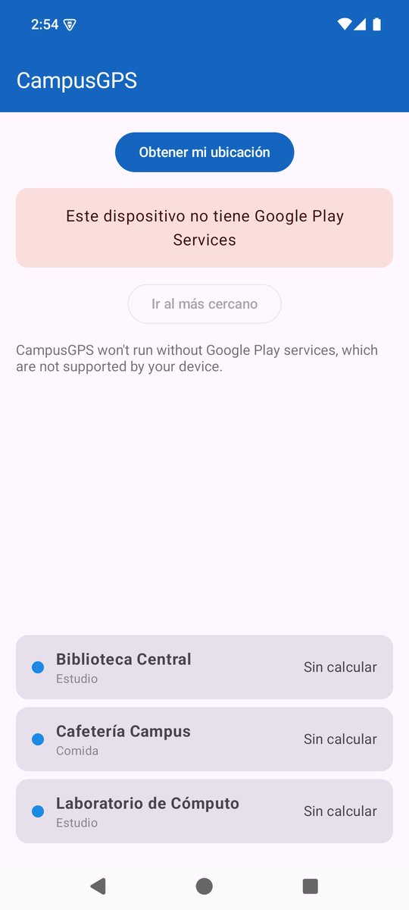 |

La captura sin Play Services es del emulador `Lab03`, que no trae Google Play
Services. El texto en inglés del centro lo dibuja el mapa de Google, no la app.

## Pruebas de aceptación

| Prueba | Resultado esperado | OK |
|---|---|---|
| Abrir la app por primera vez y pulsar el botón | Aparece el cuadro de permiso | ✔ |
| Aceptar el permiso | Se ven latitud, longitud y el marcador Estás aquí | ✔ |
| Negar el permiso | Mensaje de error con Abrir ajustes, la app no se cierra | ✔ |
| Ubicación en el punto base | Los 5 marcadores azules aparecen cerca de tu posición | ✔ |
| Tocar un marcador | Se ve el nombre y la categoría del lugar | ✔ |
| Lista de lugares | Ordenada de menor a mayor distancia, con m o km | ✔ |
| Tocar una tarjeta de la lista | La cámara viaja a ese lugar y la tarjeta queda resaltada | ✔ |
| Ir al más cercano | La cámara va al lugar verde; el botón está deshabilitado antes de buscar | ✔ |
| Cambiar la ubicación del emulador y buscar otra vez | Las distancias, el orden y el lugar verde se actualizan | ✔ |
| Ubicación apagada | Mensaje de GPS con Reintentar | ✔ |
| Rotar la pantalla | No se pierden la ubicación ni la lista | ✔ |
| Revisar el repositorio | `git grep` no encuentra la clave y `local.properties` no está subido | ✔ |

En el punto base las distancias salen 88 m (Biblioteca Central), 109 m (Cafetería
Campus), 173 m (Laboratorio de Cómputo), 220 m (Auditorio Principal) y 266 m
(Estacionamiento Norte), casi iguales a las de la guía.

## Clave de Google Maps

La clave no está en el código ni en el Manifest. Se guarda en `local.properties`,
que no se sube a GitHub:

```
MAPS_API_KEY=AQUI_VA_LA_CLAVE
```

`app/build.gradle.kts` lee ese archivo y la pasa al Manifest con
`manifestPlaceholders["MAPS_API_KEY"]`, que la pone en el `meta-data`
`com.google.android.geo.API_KEY`. Si no hay clave, la app compila igual, pero el
mapa sale gris.

Restricción de la clave en Google Cloud (Maps SDK for Android):

- Paquete: `com.leon.campusgps`
- SHA-1 de depuración (`./gradlew signingReport`):
  `1E:D0:35:9B:C2:34:82:EF:E5:22:60:B5:E8:4F:99:9B:E4:6E:75:A3`

## Para pensar

**1. ¿Por qué FusedLocationProviderClient está dentro del Repository y no en el ViewModel?**

Porque FusedLocationProviderClient necesita un `Context` para crearse, y el
ViewModel no debe recibir uno: vive más que la pantalla y guardar un `Context`
puede dejar la Activity en memoria. Además, el ViewModel solo conoce la interface
`UbicacionRepository`, así que no le importa de dónde sale la posición. Si mañana la
ubicación viene de otro servicio, o de datos falsos para probar, solo cambia la
implementación del Repository y el ViewModel queda igual.

**2. ¿Qué diferencia hay entre el permiso de ubicación y la clave de API de Maps? ¿Qué pasa si falta cada uno?**

El permiso lo da el usuario en su celular y deja que la app lea dónde está. La
clave de API la da Google Cloud al desarrollador y deja que la app use el mapa. Son
cosas separadas. Si falta el permiso, el mapa se ve igual, pero la app no sabe dónde
estás: sale el mensaje con «Abrir ajustes». Si falta la clave, o está mal puesta, la
ubicación sí funciona y la lista muestra las distancias, pero el mapa sale gris y en
Logcat aparece un error de autorización de Maps.

**3. ¿Por qué la clave va en local.properties y no en el código? ¿Qué harías si se subiera a GitHub por error?**

Porque `local.properties` está en el `.gitignore` y nunca llega al repositorio,
mientras que el código sí se sube y cualquiera que lo vea podría copiar la clave y
gastarla a nuestro nombre. Gradle la lee al compilar y la pone en el Manifest con
`manifestPlaceholders`, así que la app la recibe sin que aparezca en ningún archivo
versionado. Si se subiera por error, la borraría en Google Cloud y crearía una nueva,
porque borrar el archivo no basta: la clave ya quedó en el historial de Git.
Después revisaría que `local.properties` siga en el `.gitignore`.

**4. ¿Dónde calculas la distancia y por qué no en el Composable?**

La distancia se calcula en `util/Distancia.kt`, y quien la usa es el ViewModel, en
`actualizarDistancias`, una sola vez cuando llega la ubicación. Ahí también se ordena
la lista. Si se calculara en el Composable, se repetiría en cada recomposición (cada
vez que algo cambia en pantalla) y la lógica quedaría mezclada con el dibujo, lo que
rompe MVVM. Así, la pantalla solo dibuja la lista que ya viene calculada y ordenada.

**5. ¿Qué pasa con tu app si el usuario niega el permiso dos veces? ¿Cómo lo manejas?**

Desde Android 11, si el usuario niega el permiso dos veces, el sistema deja de
mostrar el cuadro y lo da por negado para siempre. Al pulsar el botón, el lanzador
de permisos responde enseguida que no hay permiso, sin preguntar. La app no se
cierra: llama a `permisoDenegado()` y muestra el mensaje con el botón «Abrir ajustes»,
que abre la pantalla de CampusGPS en los Ajustes de Android para que el usuario
active la ubicación a mano.

## Notas

- `maps-compose` va en la versión 6.4.1: la 8.4.0 de la guía exige Android Gradle
  Plugin 9.1 y compileSdk 37, y no compila con este proyecto. Por eso los
  marcadores usan `rememberMarkerState(position = ...)`: `rememberUpdatedMarkerState`,
  que sugiere la guía, no existe en la 6.4.1.
- El proyecto base se armó a partir de la guía del laboratorio, con los archivos
  [E] escritos siguiendo lo que describe.
- El paquete se cambió de `com.tecsup.campusgps` a `com.leon.campusgps` porque el
  docente pidió que el paquete lleve el apellido del alumno. La restricción de la
  clave de Maps en Google Cloud debe tener el paquete nuevo, o el mapa sale gris.
- En horizontal la pantalla conserva los datos, pero el mapa queda sin espacio
  porque el botón, el texto y la lista ocupan todo el alto.

## Fase 2 (rama mejora-ia)

Tres mejoras hechas con ayuda de IA. Los prompts, lo que respondió y lo que se
corrigió están en [PROMPTS.md](PROMPTS.md).

| Mejora | Qué hace | Capas que cambian |
|---|---|---|
| Filtrar por categoría | Chips Todas, Estudio, Comida, Eventos y Servicios; el mapa, la lista y el más cercano muestran solo esa categoría | ViewModel + View |
| Radio de cercanía | Chips de 100, 200 y 500 m; dibuja un círculo alrededor de mi posición y marca «Dentro del radio» en la lista | ViewModel + View |
| Seguimiento en vivo | «Seguir en vivo» actualiza la posición, las distancias y el lugar verde mientras me muevo; «Detener» lo apaga | Repository + ViewModel + View |

El seguimiento cambia el Repository: `UbicacionRepository` tiene ahora
`seguirPosicion(): Flow<Posicion>`, y `UbicacionRepositoryGoogle` la implementa con
`requestLocationUpdates` dentro de un `callbackFlow`. El ViewModel sigue sin recibir
`Context`.

| Filtro: Estudio | Radio de 100 m | Seguimiento en vivo |
|---|---|---|
| 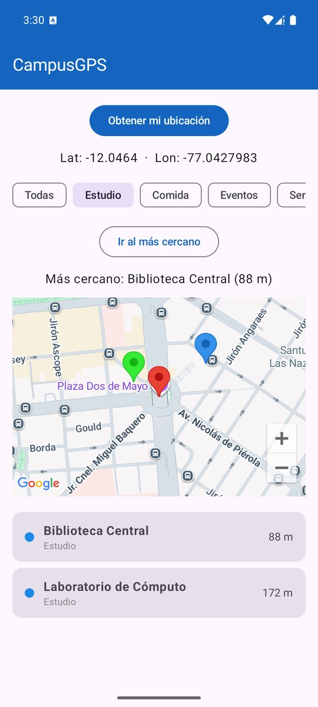 | 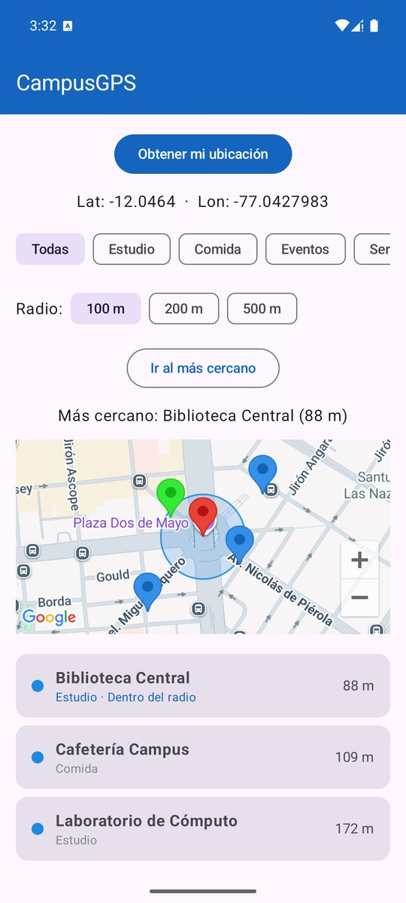 | 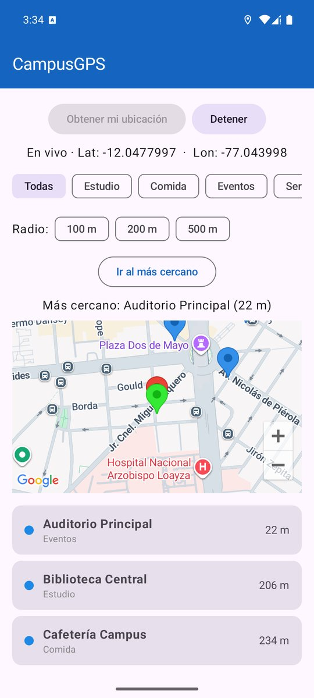 |

### Pruebas de la Fase 2

| Prueba | Resultado |
|---|---|
| Elegir Estudio | El mapa y la lista muestran solo la Biblioteca y el Laboratorio; el más cercano es la Biblioteca (88 m) |
| Elegir Comida | Solo la Cafetería Campus (109 m), que pasa a ser la más cercana |
| Tocar el chip elegido otra vez | Vuelven a verse todos los lugares |
| Radio de 100 m en el punto base | Círculo en el mapa; solo la Biblioteca (88 m) queda «Dentro del radio» |
| Radio de 500 m | Todos los lugares visibles quedan dentro |
| Seguir en vivo y mover el emulador | Sin pulsar nada, la posición, el orden y el lugar verde cambian (Auditorio 22 m, luego Estacionamiento 32 m) |
| Detener y mover el emulador | La posición ya no cambia |

### Pulido de la interfaz

Después de las tres mejoras se pulió el diseño, siguiendo reglas de movimiento para
apps móviles: respuesta al toque en menos de 100 ms, transiciones de 250 a 350 ms y
curvas suaves en vez de lineales.

| Parte | Qué cambió |
|---|---|
| Iconos | Cada categoría tiene su icono (libro, cubiertos, calendario, estacionamiento) en chips, tarjetas y lista; cada error tiene el suyo (ubicación tachada, GPS apagado, celular) |
| Panel de ubicación | Los botones «Mi ubicación» y «Seguir en vivo» van en una tarjeta con el estado debajo; el estado entra con un fundido y una barra de progreso mientras busca |
| Más cercano | Tarjeta verde con el nombre y la distancia, que se desliza cuando cambia el lugar, y un botón para ir hasta él |
| Lista | Las tarjetas se reordenan deslizándose, la distancia cambia con una animación, el borde y el color de la seleccionada se animan, y la tarjeta se achica un poco al presionarla |
| Mapa | Bordes redondeados con sombra, etiqueta «En vivo» con un punto que late, y sin la barra de Google Maps al tocar un marcador |
| Seguimiento | La cámara sigue la posición sin volver a cambiar el zoom que eligió el usuario |
| Errores | El recuadro entra con una pequeña sacudida y una vibración |
| Vibración | Los chips y las tarjetas vibran un poco al tocarlos |

| Inicio | Con ubicación | Radio y selección | En vivo | Error |
|---|---|---|---|---|
| 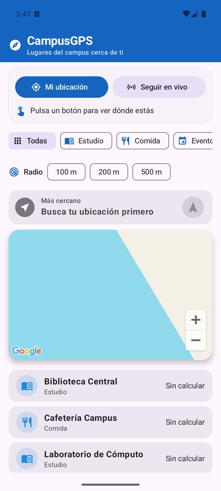 | 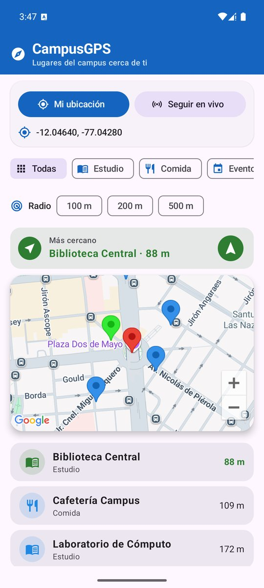 | 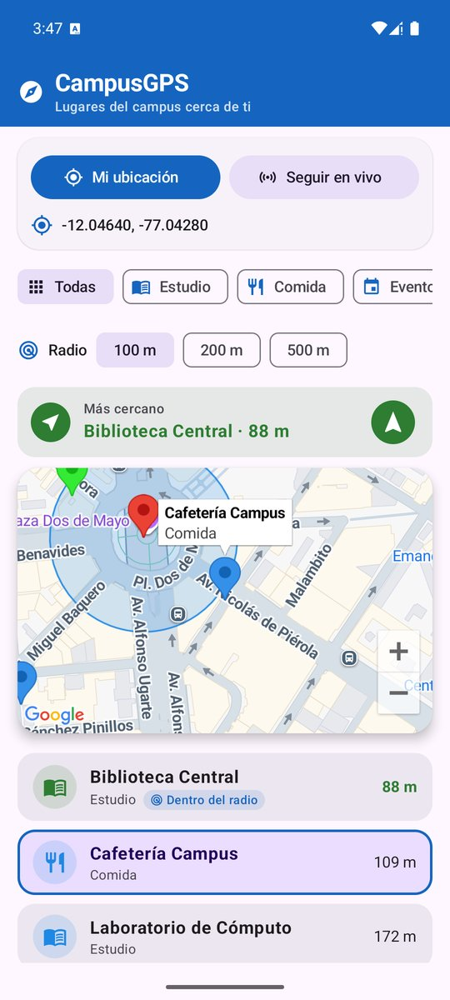 | 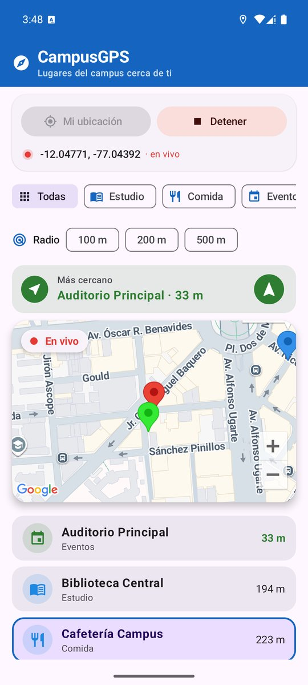 | 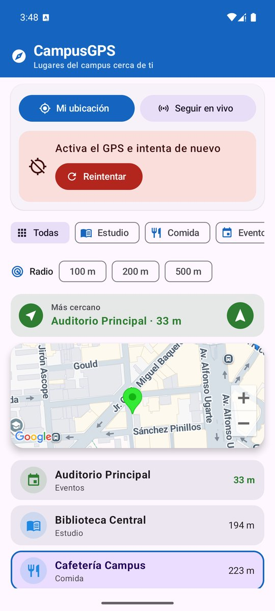 |

### Pendiente o mejorable

- En horizontal el mapa sigue sin espacio.
