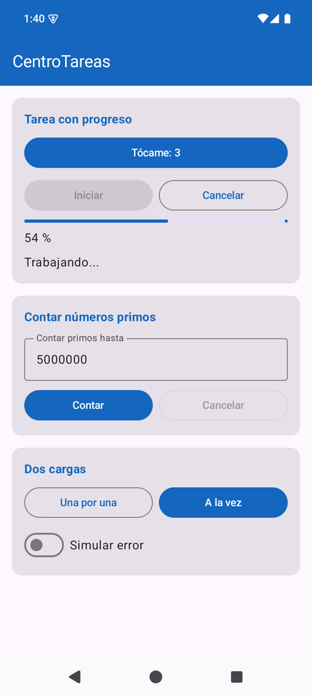
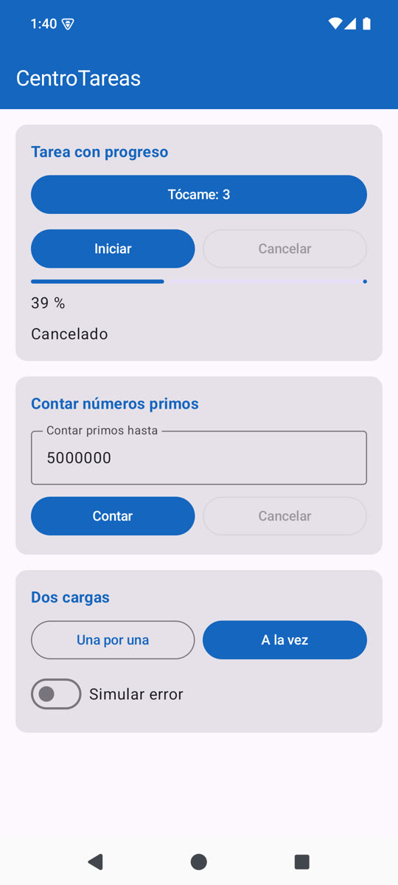
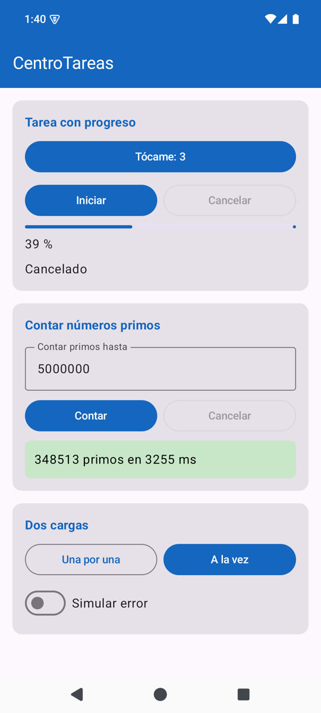
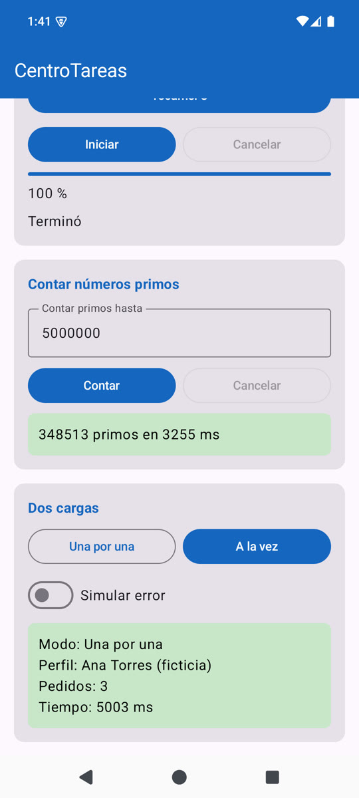
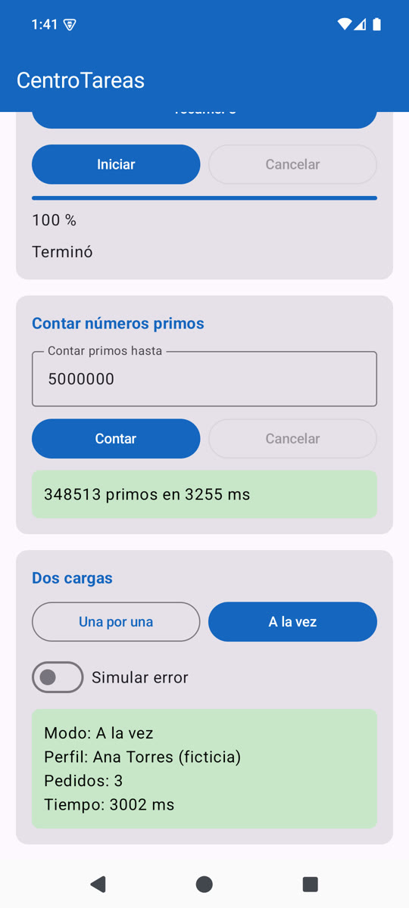
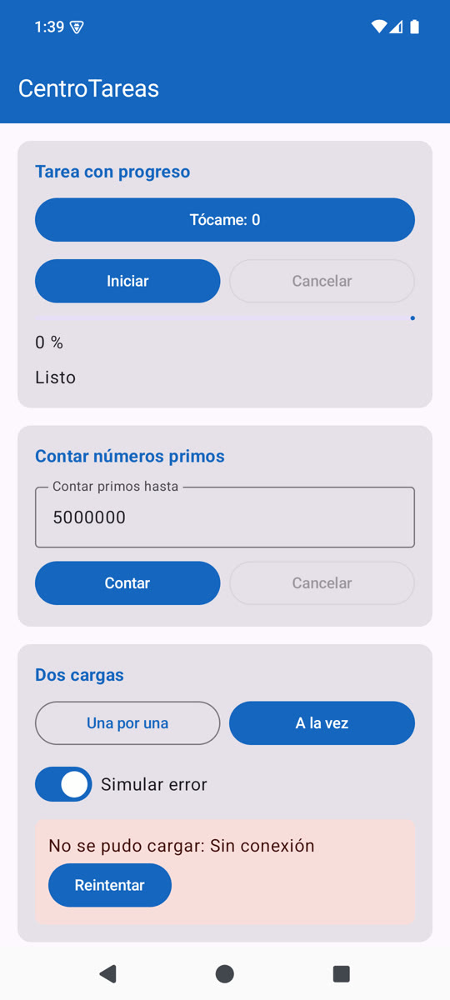

# CentroTareas

App del Laboratorio 14 (Hilos en Android). Hace tres cosas que tardan: una tarea con
barra de progreso, un cálculo pesado (contar números primos) y dos cargas de datos
simuladas. Primero muestra cómo se congela la pantalla cuando se hace mal y luego lo
resuelve con corrutinas, sin bloquear nunca el hilo principal.

- **Alumno:** Renzo León
- **Paquete:** `com.leon.centrotareas`
- **Tecnología:** Kotlin, Jetpack Compose, Material 3, corrutinas y ViewModel
- **Patrón:** MVVM + Repository (interface)
- **Datos:** todos ficticios. Las cargas se simulan con `delay`, sin internet ni permisos.

## Estructura de paquetes

```
com.leon.centrotareas/
├── MainActivity.kt                  [E]
├── model/
│   └── Estados.kt                   [E]  PrimosUi, CargaUi
├── data/
│   ├── TareasRepository.kt          [E]  interface
│   └── TareasRepositoryLocal.kt     [G]  cargas simuladas y contarPrimos
├── viewmodel/
│   ├── TareasViewModel.kt           [G]  pasos 1 a 7
│   └── TareasViewModelFactory.kt    [E]
└── ui/
    ├── PantallaTareas.kt            [G]  las tres tarjetas
    └── theme/Theme.kt               [E]
```

## Arquitectura MVVM + Repository

```
View (PantallaTareas)
   |  eventos: botones              ^  collectAsStateWithLifecycle()
   v                                |
ViewModel (TareasViewModel)  --- StateFlow --->
   |  viewModelScope.launch { ... }
   v
TareasRepository (interface)  --->  TareasRepositoryLocal
                                    (cargas simuladas y contar primos)
```

| Capa | Conoce a | No hace |
|------|----------|---------|
| View (`ui/`) | Solo a su ViewModel | No lanza corrutinas ni usa Thread; solo muestra el estado y avisa los eventos |
| ViewModel | Solo a la interface del Repository | No conoce Composables, no recibe un Context y no bloquea el hilo principal |
| Repository | Nada de la UI | No expone estados de pantalla; sus funciones `suspend` no bloquean el hilo que las llama |

## Observación del Paso 1

Al tocar **Tarea larga (MAL)** la pantalla deja de responder durante 4 segundos: el
botón **Tócame** no suma y nada se mueve. Pasados los 4 segundos, el texto cambia
directo a **Terminó**.

El texto **Trabajando...** no llega a verse porque `Thread.sleep` duerme el hilo
principal, que es el mismo que dibuja la pantalla. El valor sí cambia, pero el hilo
no tiene tiempo de dibujarlo antes de dormirse, y cuando despierta ya vale
**Terminó**.

Si la espera fuera de 10 segundos, Android mostraría el aviso **La aplicación no
responde** (ANR), que deja al usuario esperar o cerrar la app. Ese aviso sale
cuando el hilo principal no atiende un toque durante unos 5 segundos.

## Capturas

| Tarea con progreso | Tarea cancelada | Primos |
|---|---|---|
|  |  |  |

| Una por una | A la vez | Error simulado |
|---|---|---|
|  |  |  |

## Pruebas de aceptación

Probadas en el emulador Lab03 (API 35).

| Prueba | Resultado esperado | OK |
|--------|--------------------|----|
| Tarea larga: tocar Tócame mientras trabaja | El contador sigue sumando | ✔ |
| Logcat con filtro HILO | `Antes: main`, `Dentro: DefaultDispatcher-worker-2`, `Despues: main` | ✔ |
| Iniciar la tarea con progreso | La barra avanza de 0 a 100 % en unos 4 s | ✔ |
| Cancelar a mitad | La barra se detiene (39 %), dice Cancelado y se puede iniciar otra vez | ✔ |
| Pulsar Iniciar dos veces seguidas | No se lanzan dos tareas (el botón está deshabilitado) | ✔ |
| Primos hasta 100, 1000 y 10 000 | 25, 168 y 1229 | ✔ |
| Primos con N grande (5 000 000) | 348 513 primos en unos 3,2 s; la pantalla no se congela y Cancelar funciona | ✔ |
| Una por una | 5003 ms y resultado correcto | ✔ |
| A la vez | 3002 ms y resultado correcto | ✔ |
| Error simulado + Reintentar | Recuadro rojo; al desactivar el interruptor y reintentar, éxito | ✔ |
| Rotar la pantalla durante la tarea | La tarea continúa y el progreso no se reinicia | ✔ |
| Revisar el código | `git grep` no encuentra GlobalScope, runBlocking ni Thread.sleep en el código final | ✔ |

## Para pensar

**1. ¿Por qué no se veía Trabajando... en el Paso 1?**
Porque `Thread.sleep` dormía el hilo principal, que es el que dibuja la pantalla. El
mensaje cambiaba a Trabajando..., pero el hilo se dormía antes de poder dibujarlo, y
al despertar el mensaje ya era Terminó.

**2. ¿Qué diferencia hay entre Thread.sleep y delay?**
`Thread.sleep` bloquea el hilo completo: nadie más puede usarlo mientras espera.
`delay` solo suspende la corrutina y deja el hilo libre para otras cosas, como
dibujar la pantalla. Además, `delay` se puede cancelar y `Thread.sleep` no.

**3. ¿Por qué Dispatchers.Default para los primos y Dispatchers.IO para la red?**
Contar primos usa mucho procesador, y `Default` tiene tantos hilos como núcleos tiene
el equipo, que es lo justo para cálculos. La red casi siempre está esperando una
respuesta, y `IO` tiene muchos más hilos para que esas esperas no ocupen los hilos de
cálculo.

**4. ¿Qué pasaría con la corrutina si el usuario cierra la pantalla? ¿Qué papel cumple viewModelScope?**
`viewModelScope` está atado a la vida del ViewModel. Si el usuario sale de la pantalla
y el ViewModel se destruye, todas sus corrutinas se cancelan solas y no queda trabajo
suelto gastando batería. Si solo rota la pantalla, el ViewModel sigue vivo y la tarea
continúa.

**5. ¿Por qué async tarda 3 s y no 5 s? ¿Qué pasa si una de las dos cargas falla?**
Con `async` el perfil (2 s) y los pedidos (3 s) empiezan al mismo tiempo, así que el
total es lo que tarda la más lenta: 3 s. Una por una se suman: 2 s + 3 s = 5 s. Si una
falla, `coroutineScope` cancela la otra y el error llega al `catch`, que muestra el
recuadro rojo con Reintentar.

## Notas

- El proyecto base oficial está en el Drive del docente; aquí se armó a partir de la
  guía, con los archivos [E] escritos siguiendo lo que describe.
- El paquete lleva el apellido del alumno (`com.leon.centrotareas`), como pidió el
  docente.
- En este emulador, contar primos hasta 500 000 tardaba unos 280 ms. Por eso el valor
  por defecto es 5 000 000, que tarda unos 3 s y deja ver que la pantalla no se congela.
- Los Log.d con la etiqueta HILO se dejaron en el código para poder mostrarlos en
  Logcat.

## Avance

| Paso | Estado |
|------|--------|
| 0. Proyecto base | Hecho |
| 1. Provocar el congelamiento | Hecho |
| 2. Arreglarlo con una corrutina | Hecho |
| 3. Mostrar el progreso | Hecho |
| 4. Cancelar la tarea | Hecho |
| 5. Contar números primos | Hecho |
| 6. Dos cargas a la vez con async | Hecho |
| 7. Estados de error y reintento | Hecho |
| 8. Pruebas de aceptación y README | Hecho |

## Pendiente

- Fase 2 en la rama `mejora-ia`: mínimo 3 mejoras con IA y `PROMPTS.md`.
