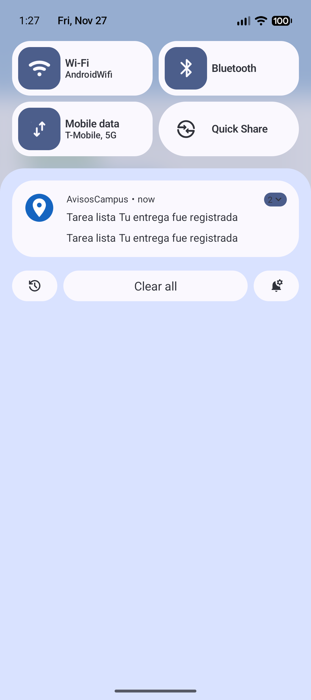
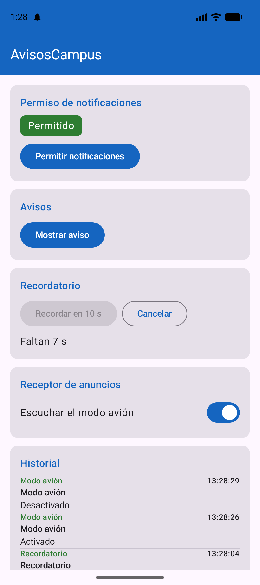
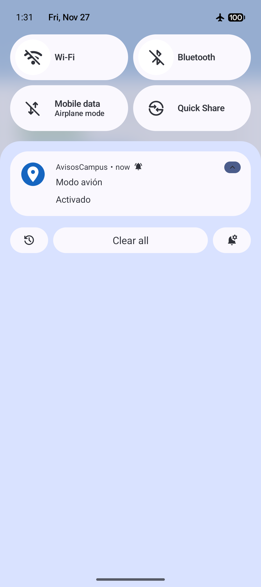
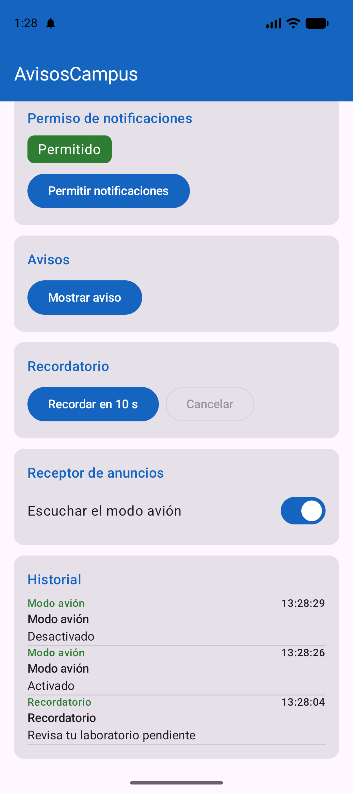
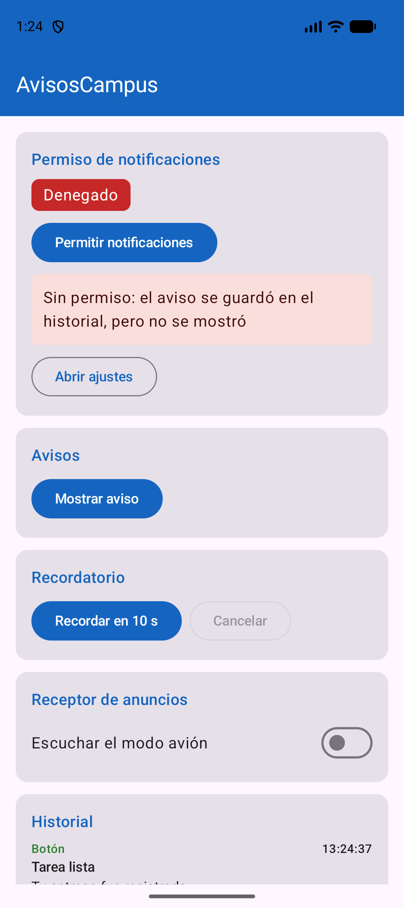
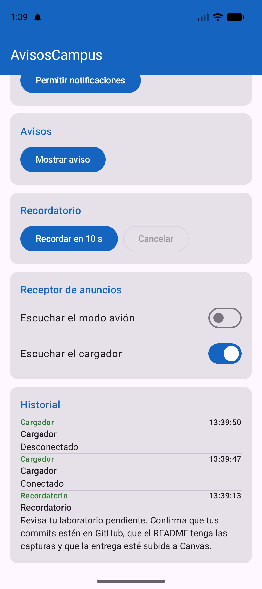

# AvisosCampus

App Android (Kotlin, Jetpack Compose, Material 3) que muestra notificaciones locales y escucha lo que pasa en el celular: un aviso inmediato, un recordatorio a los 10 segundos con cuenta regresiva y un receptor del modo avión. Todo queda anotado en un historial en memoria. Usa solo datos ficticios.

## Estructura de paquetes

```
com.tecsup.avisoscampus/
├── AvisosApp.kt
├── MainActivity.kt
├── model/Modelos.kt
├── data/AvisosRepository.kt
├── notificacion/Notificador.kt
├── receiver/ModoAvionReceiver.kt
├── viewmodel/
│   ├── AvisosViewModel.kt
│   └── AvisosViewModelFactory.kt
└── ui/
    ├── PantallaAvisos.kt
    ├── HistorialAvisos.kt
    └── theme/Theme.kt
```

## Arquitectura MVVM + Repository

```
View (PantallaAvisos)
 | eventos: botones, switch          ^ collectAsState()
 v                                   |
ViewModel (AvisosViewModel) --- StateFlow (avisos, permiso, faltan...) --->
 | registra el aviso                 | emite: eventos (SharedFlow<Aviso>)
 v                                   v
AvisosRepository (interface)        View recibe el evento y llama a
 -> AvisosRepositoryMemoria         Notificador.mostrar(context, aviso)
```

## Capturas

| Notificación en el panel | Recordatorio | Modo avión |
|---|---|---|
|  |  |  |

| Historial | Permiso denegado |
|---|---|
|  |  |

## Para pensar

**1. ¿Por qué una notificación necesita un canal y un permiso? ¿Qué pasa si falta cada uno?**
El canal (Android 8+) agrupa las notificaciones y deja que el usuario controle su importancia y sonido. El permiso `POST_NOTIFICATIONS` (Android 13+) asegura que el usuario aceptó recibirlas. Sin canal, el sistema descarta la notificación. Sin permiso tampoco se muestra; la app lo comprueba, guarda el aviso en el historial y explica cómo activarlo.

**2. ¿Por qué el ViewModel emite un evento y no muestra la notificación él mismo?**
Mostrarla requiere un `Context`. El ViewModel vive más que la pantalla, así que guardar un Context puede filtrar memoria y además lo ata a Android. Al emitir un evento solo decide qué avisar y se puede probar sin Android.

**3. ¿Qué pasa si usas el mismo id en dos notificaciones?**
La segunda reemplaza a la primera: solo queda una en el panel. Por eso se usa `aviso.id`.

**4. ¿Por qué `onReceive` debe ser corto y por qué hay que quitar el receptor al salir?**
`onReceive` corre en el hilo principal y el sistema le da poco tiempo; un trabajo largo congela la app. Si no se quita el receptor, sigue referenciando a la pantalla, se filtra memoria y pueden acumularse avisos duplicados.

**5. ¿En qué casos usarías una notificación local y en cuáles una push de Firebase?**
Local cuando el motivo nace en el celular: recordatorios, fin de una tarea o cambios del dispositivo. Push cuando nace en un servidor: un anuncio del docente, una nota publicada o un mensaje de otra persona, incluso con la app cerrada.

## Fase 2 (rama mejora-ia)

- Canal **Urgentes** para el recordatorio, además del canal Avisos.
- Texto completo al expandir la notificación (`BigTextStyle`).
- Receptor del cargador con el switch **Escuchar el cargador** (`receiver/CargadorReceiver.kt`).



Detalle de los prompts en [PROMPTS.md](PROMPTS.md).
