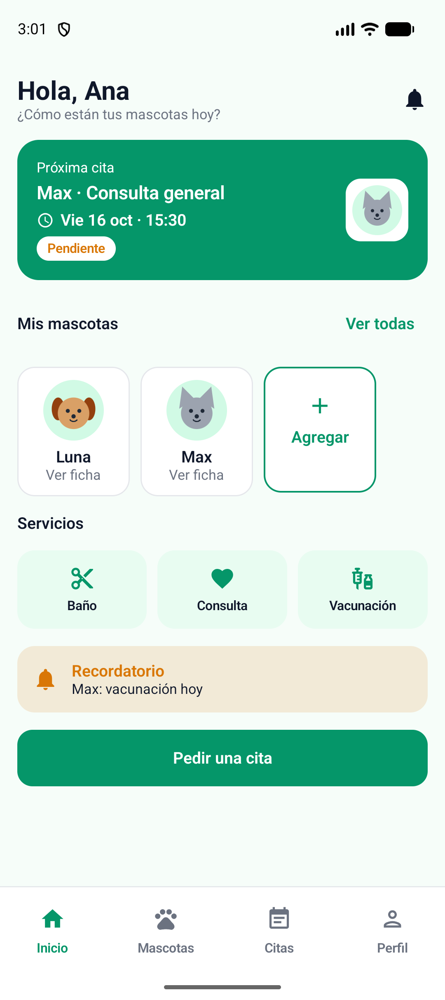
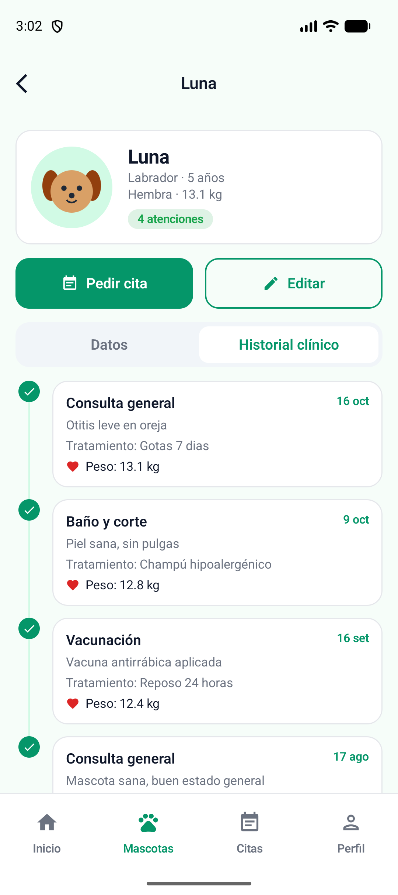
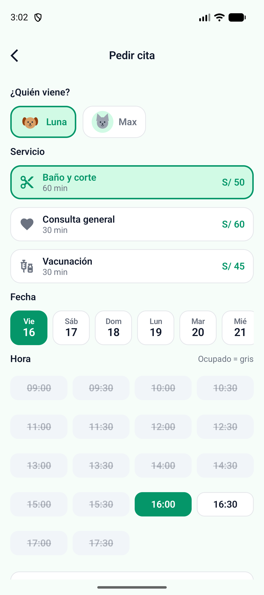
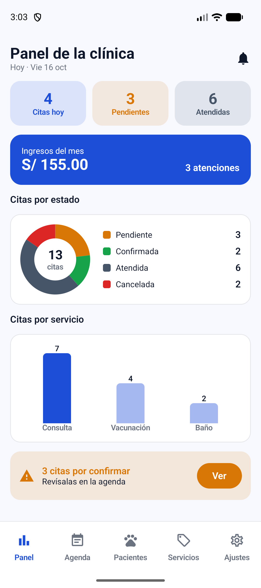
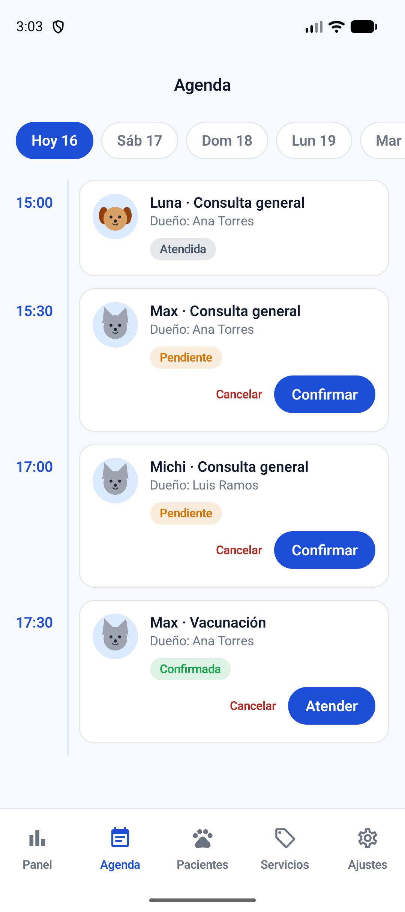
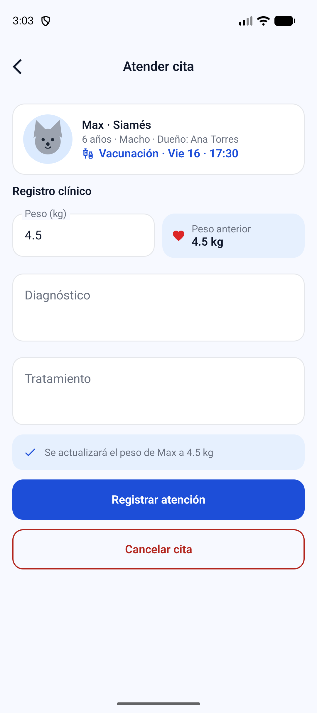

# HuellitasVet

App Android de una veterinaria con dos perfiles en el mismo dispositivo:

- **Dueño**: registra a sus mascotas, pide citas eligiendo servicio, fecha y hora, y consulta el historial clínico de cada mascota.
- **Veterinario**: ve la agenda, confirma citas, registra la atención (diagnóstico, tratamiento y peso), consulta a los pacientes y administra los servicios.

Los dos perfiles comparten la misma base de datos Room: cuando el veterinario registra una atención, el dueño la ve al instante en el historial de su mascota.

**Tecnología:** Kotlin · Jetpack Compose · Material 3 (sin XML) · Room 2.6.1 · DataStore · Navigation Compose · MVVM + Repository (interface) · minSdk 26 (java.time).

Laboratorio 08 — Programación en Móviles, TECSUP. Todos los datos son ficticios (Ley 29733).

## Usuarios de prueba

| Perfil | Correo | Clave |
| --- | --- | --- |
| Dueño | ana@correo.test | 1234 |
| Dueño | luis@correo.test | 1234 |
| Veterinario | vet@huellitas.test | admin |

## Arquitectura MVVM + Repository

```
┌──────────────────────────┐
│  View (ui/)              │  Composables: solo observan StateFlow y avisan eventos
└────────────┬─────────────┘
             │ collectAsState() / vm.accion()
┌────────────▼─────────────┐
│  ViewModel (viewmodel/)  │  Reglas de negocio, validaciones, Flow -> StateFlow
└────────────┬─────────────┘
             │ solo conoce la interface
┌────────────▼─────────────┐
│  VetRepository           │  El contrato (interface)
│  └ VetRepositoryRoom     │  Implementación con Room (transacciones)
└────────────┬─────────────┘
             │
┌────────────▼─────────────┐      ┌───────────────────────┐
│  DAO / Room (data/local) │      │  PreferenciasStore    │
│  usuarios · servicios ·  │      │  (DataStore: perfil,  │
│  mascotas · citas        │      │  modo oscuro, ajustes)│
└──────────────────────────┘      └───────────────────────┘
```

Regla de oro: una lectura que debe actualizar la pantalla es un `Flow` (sin `suspend`); una escritura o acción única es `suspend`.

## Árbol de paquetes

```
com.tecsup.huellitasvet
├── MainActivity.kt
├── VetApp.kt                      crea la base, el repository y las preferencias
├── data
│   ├── local
│   │   ├── entity                 Servicio · Usuario · Mascota · Cita
│   │   ├── dao                    ServicioDao · UsuarioDao · MascotaDao · CitaDao
│   │   ├── relation               MascotaConDueno · CitaConDetalle (relación anidada)
│   │   ├── VetDatabase.kt         singleton, 4 tablas
│   │   └── DatosIniciales.kt      siembra servicios, usuarios, mascotas y citas
│   ├── repository                 VetRepository (interface) · VetRepositoryRoom
│   └── prefs                      PreferenciasStore (DataStore)
├── model                          Rol · EstadoCita · Especie · Sexo · ConteoServicio
│                                  Horarios · UltimaVisita · Fechas
├── viewmodel                      VetViewModelFactory · Sesion · Inicio · Mascota
│                                  PedirCita · MisCitas · Panel · Agenda
│                                  AtenderCita · Pacientes · Servicios
└── ui
    ├── theme                      Color · Type · Theme (VetTheme por rol + modo oscuro)
    ├── components                 AppTopBar · VetButton · VetTextField · EstadoCitaChip
    │   │                          MascotaAvatar · CitaCard · FechaChip · HoraChip · HistorialItem
    │   └── graficos               DatoGrafico · GraficoDona · GraficoBarras
    ├── navigation                 Rutas · NavVet (grafo dueño / grafo veterinario) · BarraNavegacion
    ├── dueno                      Splash · Login · Inicio · Mascotas · FormularioMascota
    │                              FichaMascota · PedirCita · MisCitas · Perfil
    └── veterinario                Panel · Agenda · AtenderCita · Pacientes · Servicios
                                   FormularioServicio · Ajustes
```

## Capturas

| Dueño | | |
| --- | --- | --- |
|  |  |  |
| Inicio con próxima cita | Ficha con historial clínico | Pedir cita (horarios ocupados en gris) |

| Veterinario | | |
| --- | --- | --- |
|  |  |  |
| Panel con gráficos | Agenda del día | Registrar atención |

## Pruebas de aceptación (Paso 14)

| Prueba | Resultado esperado | OK |
| --- | --- | --- |
| Login con clave incorrecta | Mensaje de error, no entra | ✅ |
| Dueño: registrar mascota sin nombre | Errores junto a cada campo, no se guarda | ✅ |
| Dueño: eliminar una mascota con citas | Mensaje de aviso y no se elimina | ✅ |
| Dueño: pedir cita | Aparece en Mis citas como PENDIENTE y con el precio del servicio | ✅ |
| Dueño: elegir un horario ocupado | El horario aparece gris y no se puede elegir | ✅ |
| Veterinario: agenda | La cita aparece en su hora y puede confirmarla; el dueño la ve CONFIRMADA | ✅ |
| Veterinario: atender una cita | Pasa a ATENDIDA, el dueño la ve en el historial y el peso de la mascota se actualizó | ✅ |
| Dueño: cancelar una cita a menos de 2 horas | No se permite cancelar | ✅ |
| Veterinario: ingresos del mes | Coinciden con la suma del precio de las citas atendidas | ✅ |
| Veterinario: desactivar un servicio | Ya no se puede elegir al pedir una cita | ✅ |
| Veterinario: eliminar un servicio con citas | No se elimina; se muestra un mensaje | ✅ |
| Cerrar y abrir la app | Las citas siguen ahí y el perfil y el modo oscuro se recuerdan | ✅ |

## Para pensar

**1. ¿Por qué `VetRepository` es una interface?**
Porque los ViewModels dependen del contrato y no de Room. En la Semana 9 se podrá crear un `VetRepositoryApi` (servicio web) o uno en la nube que implemente la misma interface, y basta con cambiar qué implementación se crea en `VetApp`. Los ViewModels y las pantallas no cambian.

**2. ¿Cuándo una función del DAO devuelve `Flow` y cuándo es `suspend`?**
Si la pantalla debe actualizarse sola cuando cambian los datos (listas, contadores, historial), es `Flow`: Room vuelve a emitir cada vez que la tabla cambia. Por eso, cuando el veterinario confirma una cita, la lista del dueño cambia sin recargar. Si es una acción única (insertar, actualizar, login, contar antes de validar), es `suspend`.

**3. ¿Por qué `registrarAtencion` usa una transacción?**
Porque modifica dos tablas: pone la cita en ATENDIDA con el diagnóstico y el peso, y actualiza el peso de la mascota. Con `db.withTransaction { }` se guardan las dos cosas o ninguna; si algo falla, no queda una cita atendida con la mascota sin su peso nuevo.

**4. ¿Por qué se guarda el precio en la cita?**
Es una "foto" del momento. Si la clínica cambia mañana el precio de un servicio, las citas antiguas conservan lo que costaron y los ingresos del panel no se alteran.

**5. ¿Por qué la fecha y la hora se guardan como texto?**
El formato `aaaa-MM-dd` se ordena igual que las fechas, se compara con `=` y `>=` en SQL (por ejemplo, ingresos desde el día 1) y se convierte con `LocalDate.parse()`. Así no hacen falta `TypeConverter`.

**6. ¿Dónde viven las reglas de negocio y por qué?**
En los ViewModels: la regla de las 2 horas (`MisCitasViewModel`), el horario único y las horas pasadas (`PedirCitaViewModel`), los estados de la cita (`AgendaViewModel`, `AtenderCitaViewModel`) y las validaciones de formularios. La View solo muestra y avisa, y el DAO solo ejecuta SQL. Así las reglas se pueden probar sin pantalla y no se repiten.

**7. ¿Por qué algunos datos van en DataStore y no en Room?**
DataStore guarda preferencias pequeñas de tipo clave-valor (perfil activo, modo oscuro, notificaciones, aceptar citas). Las mascotas, citas y servicios son datos con relaciones y consultas, y por eso van en Room.

> Nota: estas respuestas cubren los temas del laboratorio. Si la guía del profesor trae preguntas de "Para pensar" con otro texto, ajusta las respuestas a esas preguntas.

## Fase 2 · Mejoras con IA (rama `mejora-ia`)

Mejoras hechas con IA respetando MVVM + Repository. Los prompts y las correcciones están en [PROMPTS.md](PROMPTS.md).

| Mejora | Estado | Capas que cambian |
| --- | --- | --- |
| Gráfico de peso de la mascota | ✅ Hecho | `CitaDao.observarPesos` + `VetRepository` + `MascotaViewModel.pesos` + `GraficoLineas` en la ficha |
| Reprogramar cita | ✅ Hecho | `CitaDao.reprogramar` + `VetRepository.reprogramarCita` + `ReprogramarCitaViewModel` + `ReprogramarCitaScreen` |
| Búsqueda de pacientes | ✅ Hecho | `MascotaDao.buscar` + `VetRepository.buscarPacientes` + `PacientesViewModel` + `PacientesScreen` |
| PROMPTS.md | ⏳ Pendiente | Documento con los prompts |

**Gráfico de peso:** en la pestaña *Datos* de la ficha aparece la tarjeta *Evolución del peso*, con una línea que une el peso registrado en cada cita ATENDIDA (de la más antigua a la más reciente), el mínimo, el máximo y la primera y la última fecha. El gráfico está dibujado con `Canvas`, sin librerías externas. Lo ven el dueño y el veterinario, y cuando el veterinario atiende una cita el punto nuevo aparece solo, porque la consulta devuelve `Flow`.

**Reprogramar cita:** en *Mis citas*, cada cita PENDIENTE o CONFIRMADA a la que le faltan más de 2 horas muestra el botón *Reprogramar*, junto a *Cancelar*. La pantalla muestra el horario actual y deja elegir otra fecha (de hoy a 7 días) y otra hora. Las reglas están en `ReprogramarCitaViewModel`:

- No se puede elegir un horario ocupado. El horario actual de la misma cita no cuenta como ocupado.
- No se puede elegir un horario que ya pasó o al que le faltan 2 horas o menos.
- El nuevo horario debe ser distinto al actual.
- Antes de guardar se vuelve a consultar si el horario sigue libre.
- La cita vuelve a quedar PENDIENTE para que la clínica confirme el nuevo horario.

**Búsqueda de pacientes:** en *Pacientes*, el veterinario escribe parte del nombre de la mascota, de la raza o del dueño y, al mismo tiempo, elige la especie (Todos, Perros, Gatos u Otros).

- En la Fase 1 el filtro se hacía en memoria, sobre la lista completa. Ahora la búsqueda la hace Room con una consulta SQL (`LIKE` con `JOIN` a usuarios y especie opcional).
- El ViewModel combina el texto y la especie con `combine` y, con `flatMapLatest`, observa la consulta nueva cada vez que cambian.
- Se muestra cuántos pacientes coinciden.
- Hay una **X** para borrar el texto y el botón *Limpiar filtros*, que quita el texto y la especie.

## Cómo ejecutar

1. Abrir la carpeta `HuellitasVet` en Android Studio y sincronizar Gradle.
2. Ejecutar en un emulador con API 26 o superior.
3. Si ya tenías instalada una versión anterior de la app, desinstálala o sube la `version` de la base. La base usa `fallbackToDestructiveMigration()`.
