# MuroCampus · Laboratorio 09: Servicios Web con Retrofit

**Alumno:** Renzo Raúl León Fernández · **Curso:** Programación en Móviles (4to ciclo, 2026) · **Docente:** Juan José León Suiyon

MuroCampus es un muro de publicaciones que viene de internet. La app consume el servicio REST
[JSONPlaceholder](https://jsonplaceholder.typicode.com/) con Retrofit y tiene cuatro funciones:

- lista las 100 publicaciones;
- abre el detalle de una publicación con sus comentarios;
- filtra por usuario;
- crea una publicación nueva.

Si no hay internet, muestra un mensaje claro con el botón Reintentar y no se cierra.

- **Tecnología:** Kotlin, Jetpack Compose y Material 3, Retrofit 2.11, OkHttp 4.12 y kotlinx.serialization
- **Patrón:** MVVM + Repository (interface)
- **Paquete:** `com.leon.murocampus`

## Estructura de paquetes

```
com.leon.murocampus/
├── MainActivity.kt                 crea el ViewModel y decide qué pantalla se ve
├── model/
│   └── Modelos.kt                  Usuario (ejemplo), Post, Comentario, NuevoPost
├── data/
│   ├── remote/
│   │   ├── PostApi.kt              interface de Retrofit (@GET, @POST, @Path, @Query, @Body)
│   │   └── RetrofitClient.kt       Retrofit + OkHttp + conversor JSON, creado una sola vez
│   └── PostRepository.kt           interface + PostRepositoryRemote (devuelve Result)
├── viewmodel/
│   ├── UiState.kt                  Cargando / Exito / Error y mensajeDe()
│   ├── PostsViewModel.kt           lista, detalle, filtro y crear
│   └── PostsViewModelFactory.kt
└── ui/
    ├── Componentes.kt              TarjetaPost, Cargando, ErrorConReintento
    ├── PantallaLista.kt            chips de usuario + lista
    ├── PantallaDetalle.kt          publicación y comentarios
    ├── PantallaCrear.kt            formulario y resultado del POST
    └── theme/Theme.kt
```

## Arquitectura MVVM + Repository

```
View (PantallaLista, PantallaDetalle, PantallaCrear)
   |  eventos: cargar, abrir, filtrar, publicar      ^  collectAsStateWithLifecycle()
   v                                                 |
ViewModel (PostsViewModel)  --- StateFlow<UiState> (Cargando / Exito / Error) --->
   |  viewModelScope.launch
   v
PostRepository (interface)  <- devuelve Result<...>
   -> PostRepositoryRemote  (atrapa la excepción y la convierte en Result.failure)
          |
          v
PostApi (Retrofit) --- OkHttp ---> https://jsonplaceholder.typicode.com/
```

- La **pantalla** solo habla con el ViewModel y dibuja el estado con un `when`.
- El **ViewModel** solo conoce la interface `PostRepository`. No usa Retrofit, `PostApi`, `HttpException` ni `Context`.
- El **Repository** nunca deja escapar una excepción: devuelve `Result.success` o `Result.failure` y vuelve a lanzar la `CancellationException`.

## Dependencias (`app/build.gradle.kts`)

| Dependencia | Para qué |
|---|---|
| `kotlin("plugin.serialization")` 2.0.21 | Genera el código que pasa el JSON a `data class` (la misma versión que Kotlin) |
| `retrofit:2.11.0` | Convierte la interface `PostApi` en llamadas HTTP |
| `converter-kotlinx-serialization:2.11.0` | Une Retrofit con kotlinx.serialization |
| `kotlinx-serialization-json:1.7.3` | Lee y escribe el JSON |
| `okhttp:4.12.0` | Hace la conexión |
| `logging-interceptor:4.12.0` | Muestra cada petición y su JSON en Logcat (filtro `OkHttp`) |
| `lifecycle-runtime-compose:2.8.7` | `collectAsStateWithLifecycle()` para leer los StateFlow |

En el Manifest va `<uses-permission android:name="android.permission.INTERNET" />`.

## La API

| Para | Verbo y ruta | Anotación |
|---|---|---|
| Listar | `GET posts` | `@GET("posts")` |
| Detalle | `GET posts/{id}` | `@Path("id")` |
| Comentarios | `GET posts/{id}/comments` | `@Path("id")` |
| Filtrar | `GET posts?userId=2` | `@Query("userId")` |
| Crear | `POST posts` con JSON en el cuerpo | `@Body` |

## Capturas

| Lista | Detalle | Filtro (Usuario 2) |
|---|---|---|
| 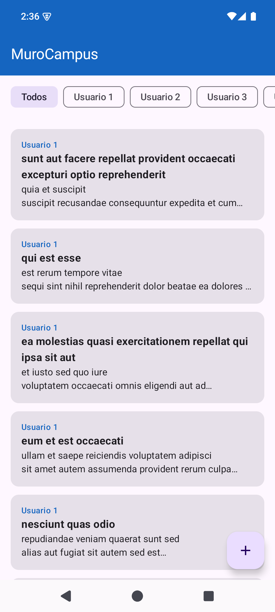 | 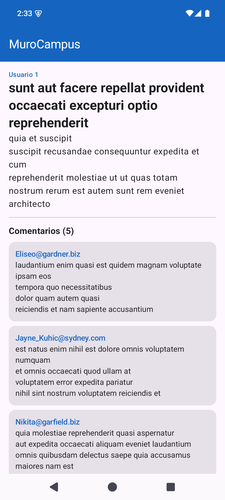 | 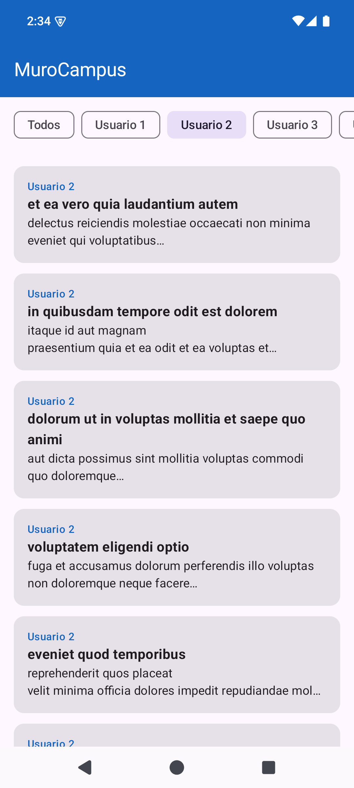 |

| Crear | Error de conexión |
|---|---|
| 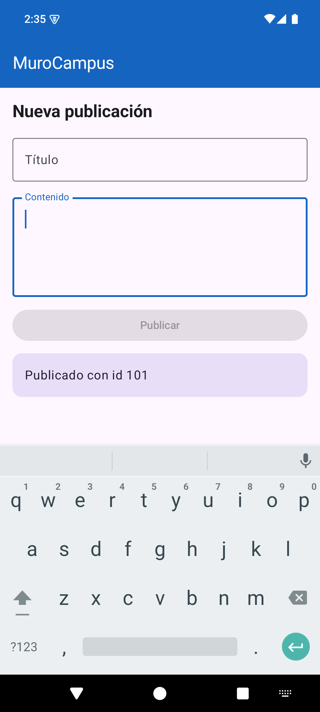 | 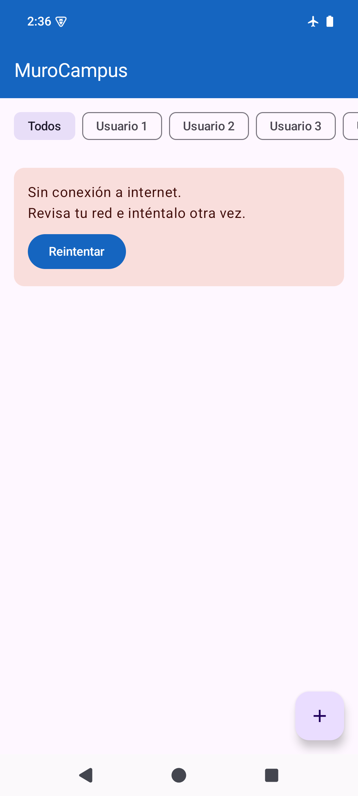 |

## Pruebas de aceptación

| Prueba | Cómo se provoca | Resultado | OK |
|---|---|---|---|
| Prueba de Retrofit (Paso 4) | `lifecycleScope.launch` temporal en MainActivity | Logcat: `Llegaron 100 publicaciones` y `<-- 200 .../posts` | ✅ |
| Sin internet | Modo avión y abrir la app | "Sin conexión a internet." con Reintentar | ✅ |
| Reintentar | Quitar el modo avión y pulsar Reintentar | Carga la lista | ✅ |
| Recurso inexistente | `posts/9999` responde 404 | `HttpException` → "Error del servidor (404)" | ✅ |
| JSON inesperado | `ignoreUnknownKeys = true` | Los campos de más no rompen la app; un campo que falta da "Respuesta inesperada" | ✅ |
| Cancelación | Abrir el detalle y volver rápido | El Repository relanza la `CancellationException`; sin errores en Logcat | ✅ |
| Lista y detalle | Abrir la publicación 1 | 5 comentarios | ✅ |
| Filtro | Elegir Usuario 2 | Solo publicaciones del Usuario 2; Logcat muestra `GET .../posts?userId=2` | ✅ |
| Crear | Enviar una publicación | "Publicado con id 101"; Logcat muestra el POST con el JSON y `<-- 201` | ✅ |
| Botón Publicar | Un campo vacío | Deshabilitado | ✅ |
| Rotar | Girar en la lista | No vuelve a descargar (el ViewModel conserva el estado) | ✅ |
| Código | Revisar `viewmodel/` | No hay Retrofit, `PostApi` ni `HttpException` en el ViewModel | ✅ |

## Para pensar

**1. ¿Qué diferencia hay entre GET y POST? ¿Por qué crear lleva @Body y porUsuario lleva @Query?**
GET pide datos y no cambia nada en el servidor. POST envía datos para crear algo nuevo.
`crear` lleva `@Body` porque manda la publicación completa como JSON en el cuerpo de la petición.
`porUsuario` lleva `@Query` porque solo agrega un filtro al final de la URL (`posts?userId=2`) y no envía cuerpo.

**2. ¿Por qué la ruta es "posts" y no "/posts"?**
Retrofit une la ruta con la URL base. Si la ruta empieza con `/`, se toma desde la raíz del dominio y reemplaza el camino que tenía la URL base.
Sin la barra, `posts` se agrega al final de `https://jsonplaceholder.typicode.com/`. Por eso la URL base termina en `/` y las rutas no empiezan con ella.

**3. ¿Por qué el Repository devuelve Result en vez de dejar que la excepción llegue al ViewModel?**
Así el ViewModel no necesita saber qué es Retrofit ni qué excepciones lanza: solo recibe éxito o fallo y lo convierte en un `UiState`.
Si una excepción escapara, la app podría cerrarse. Además, si mañana cambio la fuente de datos (otra API o una base local), el ViewModel y la pantalla siguen iguales.

**4. ¿Qué pasa si olvidas el permiso INTERNET? ¿Y si olvidas ignoreUnknownKeys y el servidor agrega un campo nuevo?**
Sin el permiso, la app compila pero no puede abrir la conexión: sale el error de red aunque el celular tenga internet.
Sin `ignoreUnknownKeys`, cuando el servidor agrega un campo que no está en la `data class`, el conversor lanza `SerializationException` y la pantalla muestra "Respuesta inesperada".

**5. ¿Por qué la pantalla de lista usa un when sobre UiState y no un if con tres variables?**
`UiState` es una `sealed interface`, así que la pantalla solo puede estar en uno de los tres estados a la vez, y el `when` obliga a dibujar los tres.
Con tres variables (cargando, error, datos) se podrían dar combinaciones imposibles, como cargando y error al mismo tiempo, y habría que acordarse de limpiar cada una.

**6. JSONPlaceholder no guarda los POST. ¿Cómo cambiaría tu app si usaras un servicio real?**
La publicación creada sí quedaría guardada. Después de publicar, la app la agregaría a la lista con la respuesta del servidor, o volvería a cargar la lista.
Además, habría que mandar un token de usuario en un encabezado y mostrar los errores de validación que devuelva el servidor (por ejemplo, 400 o 401).

## Notas

- El proyecto base del docente está en su Drive, que pide iniciar sesión. Por eso se armó a partir de la guía, con los archivos [E] escritos tal como los describe: la barra MuroCampus, `Componentes.kt`, `UiState.kt` y la Factory.
- La prueba de Retrofit del Paso 4 se borró de MainActivity antes del commit, como pide la guía.
- Se probó en el emulador Lab03 (API 35).

## Fase 2 · rama mejora-ia (con IA)

Las cuatro mejoras están explicadas en [PROMPTS.md](PROMPTS.md), con lo que cambié de lo que propuso la IA.

| Mejora | Qué hace | Capas |
|---|---|---|
| Borrar publicación | Botón Eliminar en el detalle con `@DELETE("posts/{id}")` y `Response<Unit>`. El Repository revisa el código HTTP y lo devuelve como `Result`. Avisa con un Snackbar | API + Repository + ViewModel + View |
| Búsqueda | Filtra por título lo ya descargado. El ViewModel combina la lista y el texto con `combine` | ViewModel + View |
| Interceptor | Agrega `Accept: application/json` a todas las peticiones (se ve en Logcat) | RetrofitClient |
| Pulido de la UI | Avatares por usuario, iconos, tarjetas animadas, comentarios que entran deslizándose y check con rebote | View |

| Eliminar | Eliminada | Búsqueda |
|---|---|---|
| 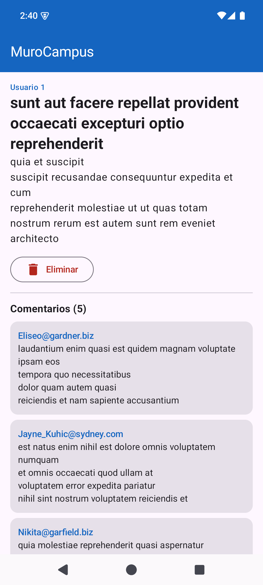 | 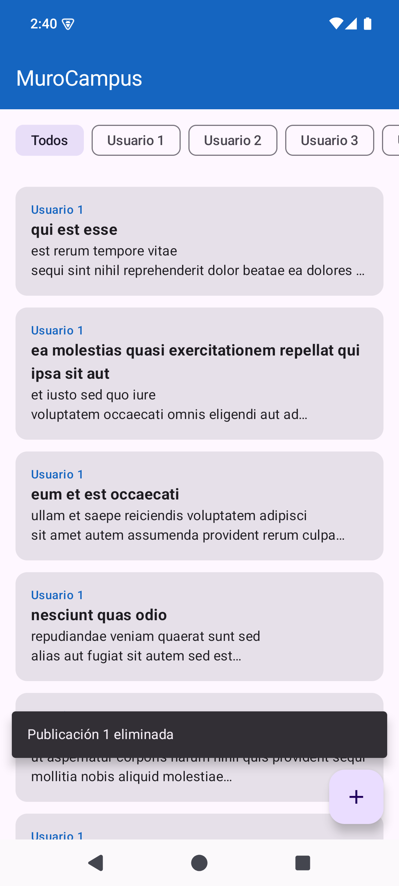 | 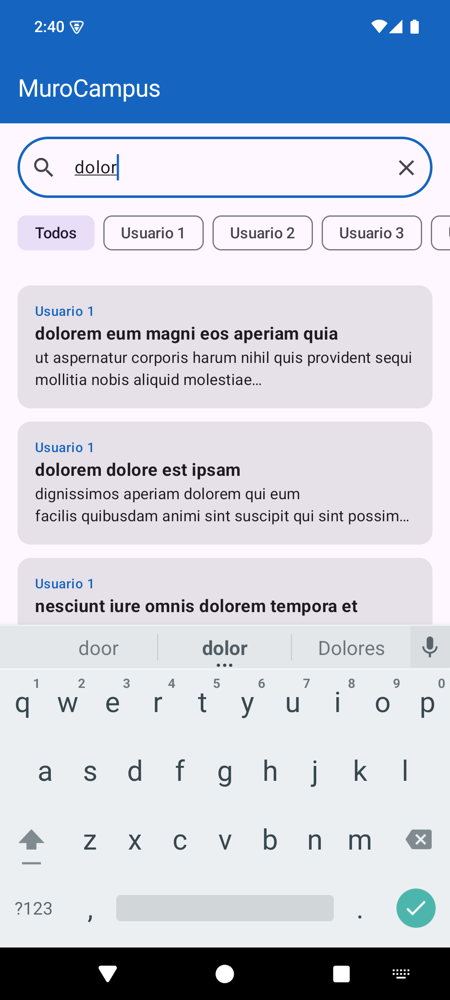 |

| Lista nueva | Detalle nuevo | Crear nuevo |
|---|---|---|
| 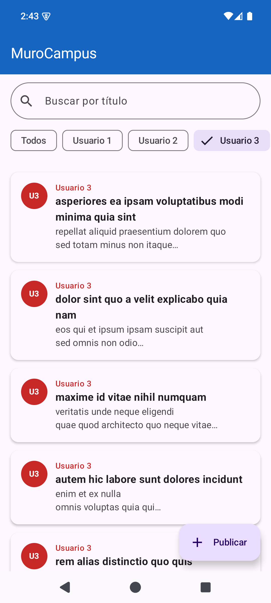 | 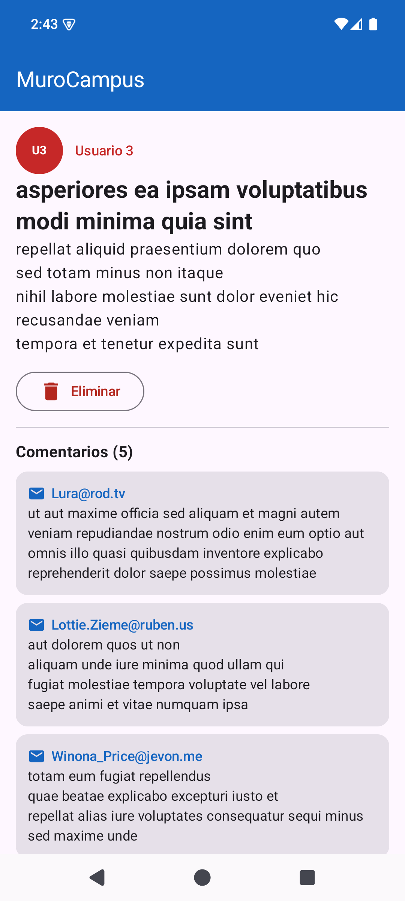 | 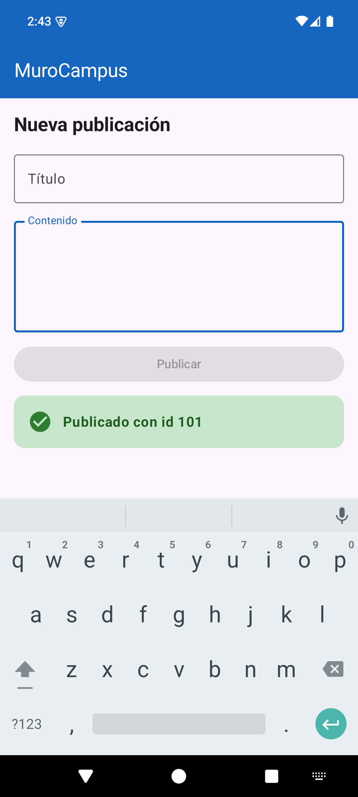 |
